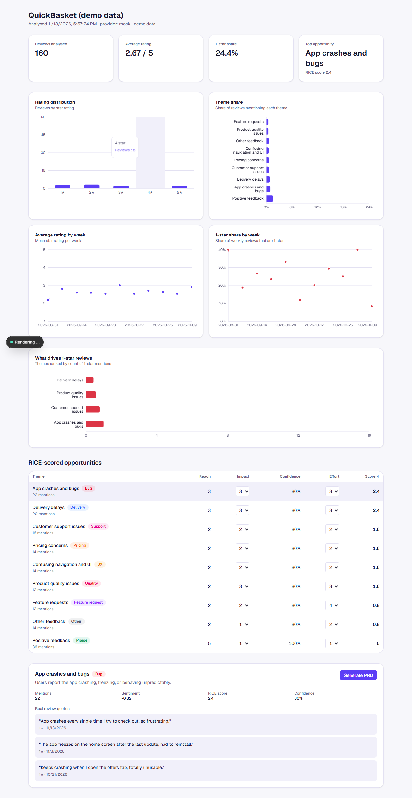
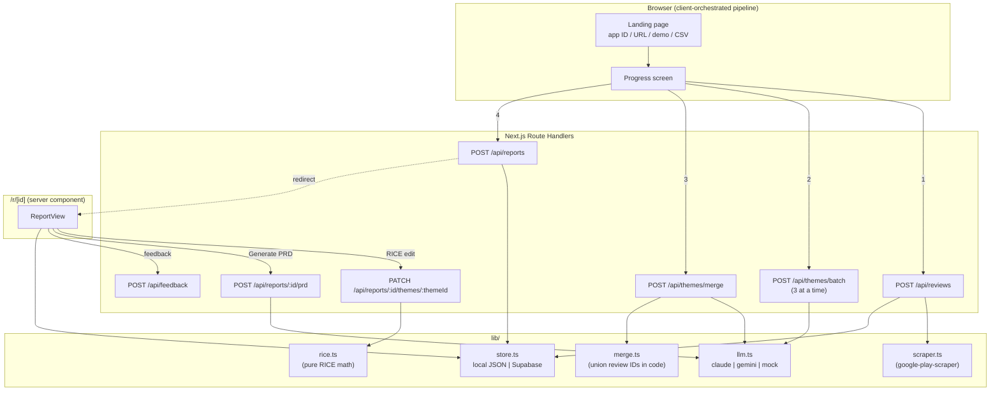

# ReviewRadar

Paste a Google Play app ID, get back review themes, RICE-scored opportunities, trend
charts, and a one-click PRD draft — grounded in real review text, not vibes.



## How it works

1. **Fetch** — up to 500 newest Play Store reviews (or your own CSV export), cached per app for 24h.
2. **Theme** — an LLM groups ~100-review batches into 3-8 themes each (run 3 batches at a time).
3. **Merge** — a second LLM pass consolidates duplicate themes into 6-10 final ones; review-ID counting happens in code, never trusted from the model.
4. **Score** — each theme gets a RICE score (Reach/Impact/Confidence/Effort), editable inline.
5. **Draft** — one click turns any theme into a one-page PRD with real quotes and counts.

The whole pipeline runs as short client-orchestrated API calls (see architecture below),
so no single serverless function has to do 500 reviews' worth of LLM work in one shot.

**Works with zero setup.** With no API key configured, `LLM_PROVIDER` defaults to
`mock`: a deterministic, offline, keyword-based theme clusterer and a template-based PRD
generator. The UI shows a "demo data" / mock-provider label whenever this is active. This
is also exactly what powers the **Try the demo** button on the landing page, which
analyses a synthetic "QuickBasket" dataset with no network call at all.

## Architecture



Why client-orchestrated steps instead of one big server call: fetching 500 reviews,
running 5+ LLM theming calls, merging, and saving can easily exceed a serverless
function's time budget. Breaking it into small POST calls driven from the browser means
each call finishes in seconds, the UI can show real progress ("Finding themes (batch 2 of
5)"), and a single slow LLM call doesn't blow the whole analysis.

## Local setup

```bash
npm install
npm run dev
```

Open [http://localhost:3000](http://localhost:3000). That's it — no `.env` file is
required. With nothing configured, ReviewRadar runs in **Demo mode**: mock LLM provider,
reviews/reports stored as JSON files under `.data/` (gitignored).

To use a real LLM or Supabase, copy `.env.example` to `.env.local` and fill in what you
have:

```bash
cp .env.example .env.local
```

### Environment variables

| Variable | Required? | What it does |
|---|---|---|
| `LLM_PROVIDER` | No | `claude` \| `gemini` \| `mock`. If unset, auto-picks `claude` if `ANTHROPIC_API_KEY` is set, else `gemini` if `GEMINI_API_KEY` is set, else `mock`. |
| `ANTHROPIC_API_KEY` | Only for `claude` | From [console.anthropic.com](https://console.anthropic.com/). |
| `CLAUDE_FAST_MODEL` | No | Used for batch theming. Default `claude-haiku-5-5`. |
| `CLAUDE_SMART_MODEL` | No | Used for merging and PRDs. Default `claude-sonnet-5-5`. |
| `GEMINI_API_KEY` | Only for `gemini` | From [aistudio.google.com/apikey](https://aistudio.google.com/apikey). |
| `GEMINI_FAST_MODEL` / `GEMINI_SMART_MODEL` | No | Default `gemini-3.8-flash`. |
| `SUPABASE_URL` / `SUPABASE_SERVICE_ROLE_KEY` | No (prod: yes) | Set **both** to use Supabase instead of local JSON files. Required in production — see below. |
| `NEXT_PUBLIC_POSTHOG_KEY` | No | PostHog project API key. If unset, all analytics calls silently no-op. |
| `NEXT_PUBLIC_POSTHOG_HOST` | No | Default `https://us.i.posthog.com`. |

### Running tests

```bash
npm run test        # vitest run, once
npm run test:watch  # vitest, watch mode
npm run typecheck   # tsc --noEmit
npm run lint        # eslint
npm run build       # next build (production build, also type-checks)
```

## Supabase setup (required for production)

Vercel's filesystem is ephemeral — the local-JSON-file store works for local dev only.
In production, set `SUPABASE_URL` and `SUPABASE_SERVICE_ROLE_KEY` and ReviewRadar
automatically switches to the Supabase adapter (`lib/store/supabase.ts`).

1. Create a free project at [supabase.com](https://supabase.com).
2. In the SQL editor, run [`supabase/schema.sql`](supabase/schema.sql) — it creates two
   tables (`reviews_cache`, `reports`), both storing the app's existing TypeScript types
   as a single `jsonb` column rather than a normalized schema (see the comment at the top
   of that file for why).
3. Copy the **Project URL** and the **service_role key** (Settings → API) into
   `SUPABASE_URL` and `SUPABASE_SERVICE_ROLE_KEY`. The service role key bypasses Row Level
   Security, which is enabled on both tables with no policies — so the anon/public key
   (never used server-side here) gets zero access if it's ever exposed.

## Deploying to Vercel

1. Push this repo to GitHub and [import it on Vercel](https://vercel.com/new).
2. Add the environment variables you want from the table above (at minimum, for a real
   deployment: an LLM key + `SUPABASE_URL` + `SUPABASE_SERVICE_ROLE_KEY`; PostHog if you
   want analytics). Without an LLM key it'll just run in demo mode for every visitor,
   which is still a fully working demo.
3. **Set `maxDuration`** on the AI-calling routes so Vercel doesn't kill a slow LLM call
   early. This is already declared in code (`export const maxDuration = 60` in
   `app/api/themes/batch/route.ts`, `app/api/themes/merge/route.ts`, and
   `app/api/reports/[id]/prd/route.ts`), but the actual ceiling depends on your Vercel
   plan — Hobby caps at 60s, Pro/Enterprise can go higher. If you're on a paid plan and
   see timeouts on large apps, raise these values (and your plan's function duration
   limit in `vercel.json` or project settings) accordingly.
4. Deploy. First request after each deploy may be slow (cold start); subsequent ones are fast.

## Project layout

```
src/
  app/                  Next.js App Router pages + API route handlers
    page.tsx            Landing page (client component, drives the pipeline)
    r/[id]/page.tsx      Report page (server component, loads from the store)
    api/                 Route handlers: reviews, themes/batch, themes/merge,
                         reports, reports/[id]/prd, reports/[id]/themes/[themeId], feedback
  components/           UI components (landing, report, shared ui/)
  hooks/useAnalysis.ts  Client-side pipeline orchestration (fetch -> batch -> merge -> save)
  lib/
    types.ts            Shared domain types
    rice.ts              RICE scoring (pure functions, fully unit-tested)
    merge.ts             Theme-candidate merging (pure, unit-tested)
    json.ts              Robust JSON extraction from LLM text output
    weeks.ts             Week-bucketing for trend charts
    llm.ts + llm/         LLM provider interface: claude, gemini, mock
    store.ts + store/     Storage interface: local JSON files, Supabase
    scraper.ts           google-play-scraper wrapper
    analytics.ts         PostHog wrapper (events, funnel, A/B flag)
test/                   Vitest unit tests
docs/                   Product docs (PRD, interview guide, metrics, A/B plan, case study)
supabase/schema.sql     Supabase table definitions
```

## Tech stack

Next.js 16 (App Router) + TypeScript + Tailwind CSS v4 · `google-play-scraper` ·
`@anthropic-ai/sdk` / `@google/genai` behind one `lib/llm.ts` interface · `zod` for LLM
JSON validation · Recharts · `posthog-js` · `papaparse` · `react-markdown` · Vitest ·
Supabase · Vercel.

## What's documented in `/docs`

- [`docs/PRD.md`](docs/PRD.md) — the PRD for ReviewRadar itself.
- [`docs/user-interview-guide.md`](docs/user-interview-guide.md) — interview questions + a notes-synthesis template.
- [`docs/metrics.md`](docs/metrics.md) — North Star, funnel, guardrails, mapped to the exact PostHog events in code.
- [`docs/ab-test-plan.md`](docs/ab-test-plan.md) — the `onboarding_variant` A/B test plan.
- [`docs/case-study.md`](docs/case-study.md) — portfolio write-up (with `[TODO: real number]` placeholders for anything that needs real usage data).

See also [`DECISIONS.md`](DECISIONS.md) for a running log of build decisions and why.
